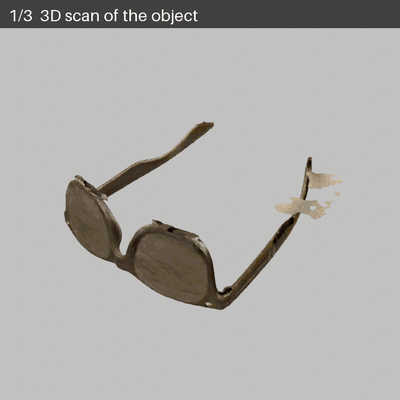

# Synthetic Object Detection

Detecting and segmenting my pair of sunglasses with YOLO trained only on synthetic images as a passion project. A 3D scan of the object is rendered with BlenderProc in randomized scenes, and the labels come from the renderer.



## Approach

- `generate.py` renders the scan with random camera poses, HDRI backgrounds, brightness, lights, materials and occluding shapes. About 10% of images contain no object. Train, val and test use different HDRIs.
- `export_yolo.py` converts the rendered masks into YOLO segmentation labels, so boxes cover only the visible part.
- `validate.py` checks the labels and prints size and position statistics.
- `evaluate.py` reports mAP, recall and the miss rate per randomization factor. `generate.py --focus` uses those miss rates to render more images where the model fails.

## Usage

```
pip install -r requirements.txt
sh run.sh
python webcam.py runs/focus/weights/last.pt
```

`run.sh` downloads the HDRIs from Poly Haven, renders 2,500 images, then trains and evaluates three YOLOv8n-seg models. Set `train.device` in `config.yaml` (`0` for CUDA, `mps`, or `cpu`).

## Results

Synthetic test set with unseen HDRIs (400 images), 20 epochs.

| Training images | Box mAP50-95 | Mask mAP50-95 | Recall |
|---|---|---|---|
| 1,000 | 0.834 | 0.551 | 0.948 |
| + 400 uniform | 0.841 | 0.557 | 0.957 |
| + 400 failure-focused | 0.851 | 0.563 | 0.951 |

The images that were supposed to be focused on failure points did not clearly outperform uniformly sampled ones. Most remaining misses are dark scenes and objects split by occluders.

## Original version

`original/` contains the original implementation, which had the object always centered, no occlusion, box labels only, and no split by HDRI. The occlusion, segmentation labels, validation and failure-driven generation are new.
